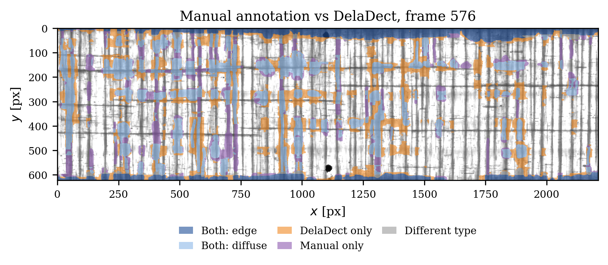
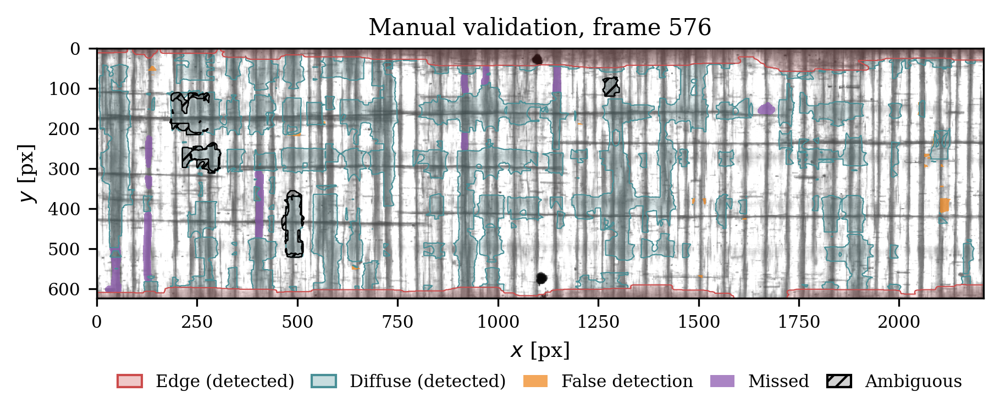
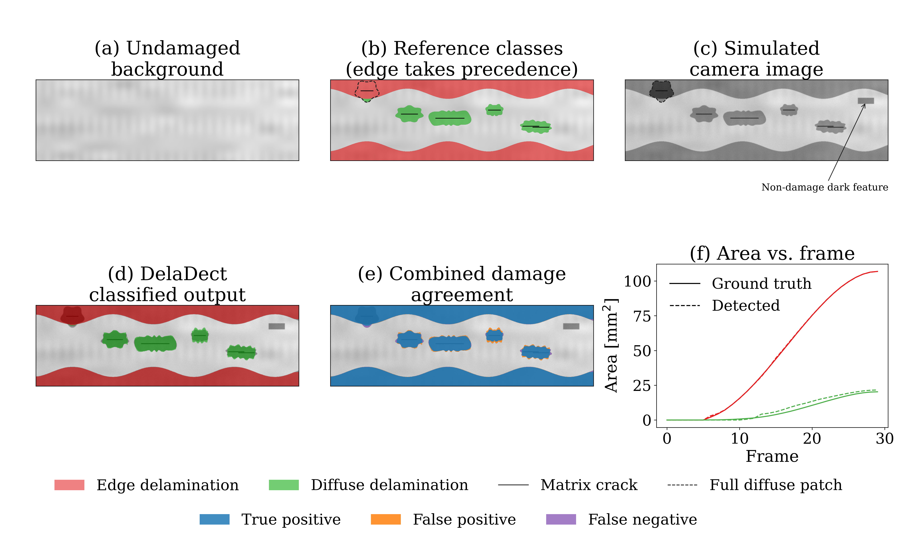
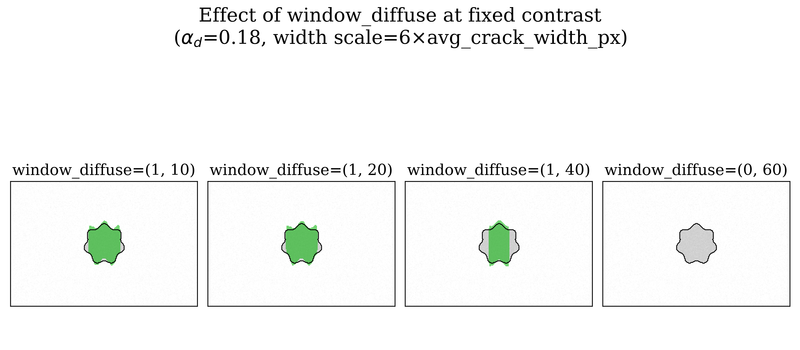

03 - Validation
===============

This page is focused on the validation of the detection algorithm and it contains two parts:
manual validation of the detection on a real frame, and a synthetic validation where some
detection parameters are tested on artificial images with known damage masks.

.. _manual-validation:

Manual validation
-----------------

The final frame (576) of the :doc:`getting_started` full-frame example was first
evaluated manually and blindly by a human evaluator, without access to the detection results, and then
compared with the tool output. The validation consists of three steps:

1. **Annotation.** Edge and diffuse delamination were first painted on the
   raw frame without any auxiliary information.
2. **Revision.** The annotation was then revised after seeing the
   detection. The scores below use this revised annotation, so they are not
   blind.
3. **Review.** The remaining disagreements were reviewed. Areas judged
   to be false detections, missed damage, or ambiguous were marked. The
   unmarked disagreements were accepted as differences in outline.

   Frame 576, manual annotation vs. DelaDect.

   Detection on frame 576 after review.

.. list-table::
   :header-rows: 1

   * - Quantity
     - Edge
     - Diffuse
   * - Tool's detection (% of frame)
     - 8.5
     - 25.1
   * - Manually annotated (% of frame)
     - 8.1
     - 19.0
   * - Area percentage detected by both (% of frame)
     - 87
     - 70

For edge delamination, 87% of the manually annotated area was detected by the tool,
compared to 70% for diffuse delamination. In both cases, the detector identified larger
delaminated areas than the human annotator. This difference was mainly due to the extent
of the detected regions, as the human annotator generally drew narrower bands while the
detector identified wider regions. Therefore, most disagreements concerned the boundaries
of the same damage regions rather than the identification of damage itself.

Since delamination does not have clearly defined boundaries, its extent is difficult to
assess, and subtle differences in image contrast may be interpreted differently by individual
observers. Furthermore, the normalization step removes background variations, allowing the
detector to identify faint damage that may be less visible to the human eye. The detection parameters could
also have been further adjusted to reduce the missed detections.

After review:

* **False detections** cover 0.16% of the frame (0.5% of the detected area),
  mostly small isolated spots.
* **Missed damage** covers 1.1% of the frame

.. _synthetic-validation-result:

Synthetic validation
--------------------

To further validate the program and evaluate the sensitivity of the detection parameters,
a synthetic validation was performed. An artificial sequence of 30 frames was generated with
progressively growing edge and diffuse delamination. The crack locations were predefined and
supplied to the detector. The same parameter configuration was used throughout the analysis, including
``window_diffuse=(1, 15)`` and ``edge_exclusion_px=0``.

   **(a)** Undamaged background. **(b)** Reference damage classes, with edge
   damage taking precedence over diffuse damage. **(c)** Simulated camera image.
   The dashed outline in (b) and (c) shows the full upper-left diffuse patch,
   including its overlap with edge damage. Both contributions darken the
   simulated image there. The upper-right rectangle is an artificial
   non-damage feature and is excluded from the reference masks.
   **(d)** Detection: red = edge, green = diffuse.
   **(e)** Combined damage agreement (blue), excess (orange), and missed
   damage (purple); this panel does not distinguish damage classes.
   **(f)** Known (solid) and detected (dashed) area. Panels (b)-(e) show
   the final frame.

True damage area correctly detected is the share of the reference damage
area that the detector marks as the same damage type. Area marked by both
is the area that is both known
and detected. Area error is positive for overestimation and negative for
underestimation. Combined masks count overlapping damage once.

.. list-table:: Final-frame results
   :header-rows: 1

   * - Damage type
     - True damage area correctly detected, final frame (%)
     - Area marked by both, final frame (% of frame)
     - Area error, final frame (%)
   * - Edge
     - 99.7
     - 34.5
     - +0.04
   * - Diffuse
     - 96.6
     - 6.3
     - +6.58
   * - Combined
     - 99.3
     - 40.9
     - +1.09

The smaller window improves diffuse delamination coverage 
and mask overlap, but also leads to a slightly larger excess area.
 However, not all metrics improve. The mean absolute diffuse area 
 error increases from 43.7% to 44.9%, while the mean combined IoU 
 decreases from 0.934 to 0.933. Both settings correctly identify the 
 initial frames as undamaged. It should also be noted that the same 
 synthetic sequence was used for parameter selection and evaluation, 
 so these results do not necessarily reflect the performance on independent images.

.. dropdown:: How the artificial sequence is generated

   Each of the 30 frames starts from an undamaged background with a smooth
   illumination gradient, low-frequency texture, and faint stitching patterns.
   Dark regions are added using

   .. math::

      \begin{aligned}
      I_n &= g_n B\,[1 - \alpha_e E_n - \alpha_d D_n \\
          &\qquad\quad - \alpha_c C_n - \alpha_x X_n] + \eta_n.
      \end{aligned}

   Here, :math:`E_n`, :math:`D_n`, and :math:`C_n` are the edge-delamination,
   diffuse-delamination, and crack masks. :math:`X_n` is a disconnected
   dark rectangle, excluded from the reference damage masks.
   :math:`g_n` introduces 2% brightness drift and :math:`\eta_n` is
   noise. The implementation blurs the attenuated image before adding
   noise, then clips it to 8-bit range. Frame 0 contains no cracks or
   damage and uses the background directly as the undamaged reference.

   **Cracks.** For this example six horizontal cracks appear together at frame 2 and do not
   grow. Their exact ``(y, x)`` endpoints are supplied to diffuse detection.
   The diffuse patch around the upper-left crack overlaps the edge region
   to exercise the edge-precedence rule.

   **Edge delamination.** Wavy fronts grow smoothly inward from both
   specimen borders, starting at frame 4. The dark rectangle stays near
   the top front but is always separated from it by at least one
   undamaged row.

   **Diffuse delamination.** Regions grow around the cracks as ellipses,
   a narrow band, and a two-lobed shape.
   Overlapping edge and diffuse pixels are assigned to edge damage.
   Raw edge and diffuse masks are first accumulated over time. The accumulated
   edge mask is then subtracted from the diffuse mask, matching the detector's
   classification rule. A pixel can therefore change from diffuse to edge as
   the edge front advances, while the combined damage remains accumulated.

.. _synthetic-validation-window-diffuse:

Effect of filter size
---------------------

``window_diffuse`` controls the filter used to suppress cracks before
segmenting diffuse damage. A window too wide for delamination can remove
it as well see :doc:`../image_operations`.

   Same image for four filter windows.

For this region, ``(1, 10)`` and ``(1, 20)`` detect 92% and 91% of the known
damage. With ``(1, 40)`` this falls to 67%; ``(0, 60)`` removes the region
entirely.

The idea of this window is to reduce the crack contribution towards the diffuse 
delamination detection. Ideally, if a detected crack has no delamination around it,
the filter should remove it completely. Hence the average crack width can be used to set the window size.
However, sometimes cracks are not straight, which then means that the projection of the crack onto the 
image is wider than the actual crack width. So the crack width should always be considered a lower bound for the filter size.

