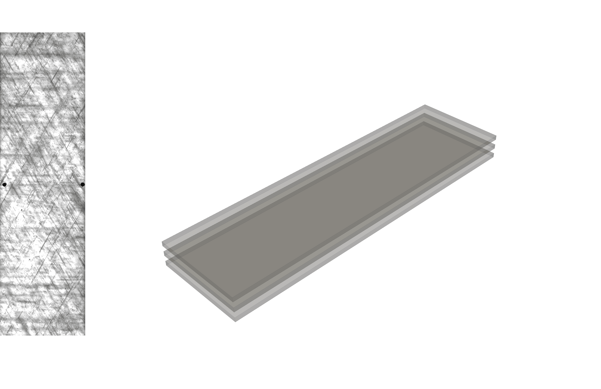

DelaDect: Optical Delamination Detection in Fiber-Reinforced Polymers
=====================================================================

DelaDect is a Python package for quantitative damage analysis in 
fiber-reinforced polymers. Out of the box, the tool is able to perform the detection of cracks
and delamination from a sequence of images. 

The tool is capable of distinguishing between diffuse and edge delamination
and can also distinguish delamination between multiple interfaces under certain conditions (see :doc:`methodology` for details).

If you are new here, start with :doc:`examples/getting_started` after the installation steps below.

Quick Start
-----------

It is recommended to use DelaDect in an isolated environment (venv or Conda) so dependencies remain
reproducible and separate from the system's Python.

Installation
~~~~~~~~~~~~
DelaDect requires **Python 3.10** (any 3.10.x release). NumPy is restricted to
versions below 2.0 for compatibility with CrackDect.
Create and activate a fresh Conda environment:

.. code-block:: bash

   conda create -n deladect python=3.10 pip
   conda activate deladect

Until DelaDect is published on PyPI, install it from source:

.. code-block:: bash

   git clone https://github.com/VascoPires/DelaDect.git
   cd DelaDect
   python -m pip install .

For development, use ``python -m pip install -e ".[dev]"`` instead.
Check the installation with:

.. code-block:: bash

   python --version
   python -c "import deladect; print(deladect.__version__)"

.. _prerequisites:

Prerequisites
-------------

DelaDect dependencies are installed automatically. 

- `CrackDect ≥ 0.2 <https://pypi.org/project/crackdect/>`_
- `NumPy ≥ 1.23.5, < 2 <https://numpy.org/>`_
- `SciPy ≥ 1.10.0, < 1.13 <https://scipy.org/>`_
- `Pandas ≥ 1.3.5, < 2.2 <https://pandas.pydata.org/>`_
- `Matplotlib ≥ 3.7.5 <https://matplotlib.org/>`_
- `scikit-image ≥ 0.18.1, < 0.23 <https://scikit-image.org/>`_
- `Pillow ≥ 8.4.0 <https://python-pillow.org/>`_

The shift-correction GUI also requires Tk and a graphical desktop. If Tk is
missing from the Conda environment, install it with ``conda install tk``.
Launch the GUI with ``shift_correction``; see :doc:`shift_correction` for instructions.

There are binder notebooks available in this repository to run the examples without installing DelaDect. 
You can access it at
`Binder <https://mybinder.org/v2/gh/VascoPires/DelaDect/HEAD?labpath=notebooks/getting_started.ipynb>`_.

.. toctree::
   :maxdepth: 1
   :caption: Examples
   :hidden:

   examples/getting_started
   examples/delamination_multi_interface
   examples/synthetic_validation

.. toctree::
   :maxdepth: 1
   :caption: User Guide
   :hidden:

   shift_correction
   Image_pre_processing
   methodology
   image_operations
   results_storage

.. toctree::
   :maxdepth: 1
   :caption: Reference
   :hidden:

   detection

.. toctree::
   :maxdepth: 1
   :caption: Project Information
   :hidden:

Authors
~~~~~~~
The current code base was developed by
`Vasco D. C. Pires <www.vascodcpires.com/>`_ with affiliation to the
`Institute Designing Plastics and Composite Materials (TU Leoben) <https://www.kunststofftechnik.at/en/konstruieren>`_.

License
~~~~~~~
This project is licensed under the AGPL-3.0 License.
